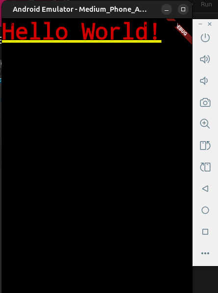
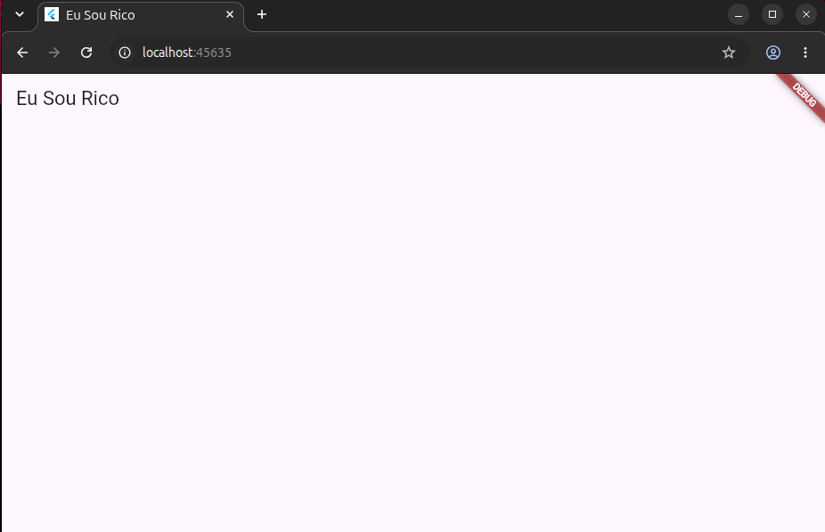

# App - Eu Sou Rico
### Step by step to build the app
1. create a new flutter project
```bash
flutter doctor
flutter create eu_sou_rico
cd eu_sou_rico
```
To run in a web browser (optional)
```bash
flutter create . --platforms web
flutter run -d chrome
```

2. Erase all classes, leaving only the following source code:
```dart
import 'package:flutter/material.dart';

void main() {
  runApp(const MyApp());
}
```

3. Replace MyApp by MaterialApp
```dart
import 'package:flutter/material.dart';

void main() {
  runApp(const MaterialApp(
    title: 'Eu Sou Rico',
    home: Text('Hello World!'),
    ),
  );
}

```

<!--
Source - https://stackoverflow.com/a/41912122
Posted by Philipp Schwarz, modified by community. See post 'Timeline' for change history
Retrieved 2026-09-26, License - CC BY-SA 4.0
-->



4. Use widget Center to put the text in the center of the screen
```dart
import 'package:flutter/material.dart';

void main() {
  runApp(const MaterialApp(
    title: 'Eu Sou Rico',
    home: Center(
      child: Text('Hello World!'),
    ),
    ),
  );
}
```

5. Add widgets Scaffold and AppBar
```dart
void main() {
  runApp(MaterialApp(
    title: 'Eu Sou Rico',
    home: Scaffold(
      appBar: AppBar(
        title: Text('Eu Sou Rico'),
      ),
    ),
  ));
}
```



6. Adding a background color to the AppBar and font properties to the title.
```dart
void main() {
  runApp(MaterialApp(
    title: 'Eu Sou Rico',
    home: Scaffold(
      appBar: AppBar(
        backgroundColor: Colors.blueGrey[900],
        title: Text('Eu Sou Rico', 
          style: TextStyle(
            fontSize: 24,
            fontWeight: FontWeight.normal,
            color: Colors.white,
          ),
        ),
      ),
    ),
  ));
}
```

7. **Challenge**: consult the documentation for the Scaffold widget and figure out how to add a blue gray color to the screen's white background (not the app bar).

[Scaffold class](https://api.flutter.dev/flutter/material/Scaffold-class.html)

Desafio: consulte a documentação do widget Scaffold e descruba como colocar uma cor cinza azulado no lugar do fundo branco da tela (não na appbar).

8. Solution to challenge:
```diff
void main() {
  runApp(MaterialApp(
    title: 'Eu Sou Rico',
    home: Scaffold(
+     backgroundColor: Colors.blueGrey,
      appBar: AppBar(
        backgroundColor: Colors.blueGrey[900],
        title: Text('Eu Sou Rico', 
          style: TextStyle(
            fontSize: 24,
            fontWeight: FontWeight.normal,
            color: Colors.white,
          ),
        ),
      ),
    ),
  ));
}
```

9. Adding a network image to the body of the Scaffold

You can go to Google an type 'image' to get any image on the web. Open the selected image in a new tab and copy the url.

```dart
void main() {
  runApp(MaterialApp(
    title: 'Eu Sou Rico',
    home: Scaffold(
      backgroundColor: Colors.blueGrey,
      appBar: AppBar(
        backgroundColor: Colors.blueGrey[900],
        title: Text('Eu Sou Rico', 
          style: TextStyle(
            fontSize: 24,
            fontWeight: FontWeight.normal,
            color: Colors.white,
          ),
        ),
      ),
      body: Image(image: NetworkImage('https://encrypted-tbn0.gstatic.com/images?q=tbn:ANd9GcTOJ4IZbkwwyJD4dq7MObC7x1gpYN0xVkTOV_X9T9ZCMQ&s=10'),)
    ),
  ));
}
```
